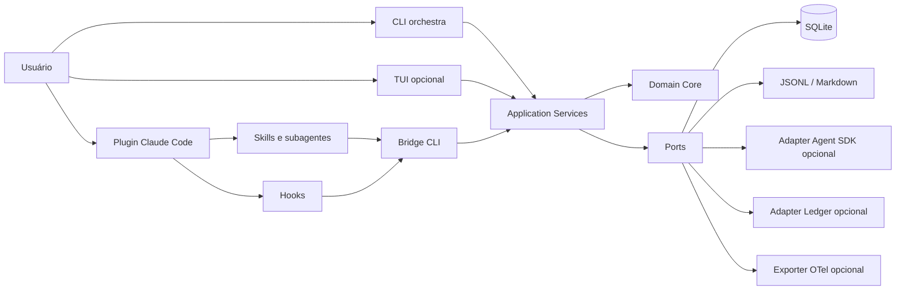

# Arquitetura do Orchestra Core

## Objetivo arquitetural

Disponibilizar 36 competências especializadas sob demanda, usando o menor conjunto suficiente para cada tarefa. O plano de controle é determinístico e local-first; LLMs entram somente onde interpretação, planejamento ou julgamento técnico agregam valor.

## Princípios

1. **Native-first:** plugin, skills, subagentes e hooks oficiais são a interface primária.
2. **Core independente:** estado, routing, budgets, contratos e auditoria não dependem de Claude, Ledger, TUI ou rede.
3. **Dependency rule:** adapters dependem do core; o core não importa adapters.
4. **Fail closed:** schema, estado, permissão ou orçamento inválido bloqueia a operação.
5. **Evidence over assertion:** `COMPLETED` requer critérios e evidências registrados.
6. **Progressive disclosure:** catálogo mínimo em contexto; instruções detalhadas sob demanda.
7. **Local-first:** SQLite, JSONL e Markdown/JSON; nenhum servidor permanente obrigatório.
8. **Honest telemetry:** toda métrica carrega proveniência `observed`, `calculated`, `estimated` ou `unknown`.

## Visão de componentes



O plugin não contém uma segunda implementação do workflow. Skills descrevem intenção e chamam a CLI; o core valida e persiste. No modo nativo, o Claude Code executa a skill/subagente e o bridge. No modo programático, o adapter Agent SDK chama os mesmos application services e schemas.

## Camadas e dependências

```text
src/orchestra/
  domain/          entidades, enums, policies e erros; zero I/O
  application/     use cases, ports, DTOs e coordenação transacional
  infrastructure/  SQLite, JSONL, filesystem, clock e subprocess adapters
  adapters/
    claude_code/   bootstrap, plugin bridge e validação
    agent_sdk/     execução programática opcional
    ledger/        manifesto/eventos unidirecionais
    otel/          exportação opcional
  cli/             argparse, render texto/Rich e exit codes
  tui/             Textual opcional; apenas application ports
```

Dependências permitidas:

```text
CLI / TUI / Plugin / SDK / Ledger → Application → Domain
Infrastructure ───────────────────→ Application ports + Domain
Domain ───────────────────────────→ stdlib apenas
```

## Estrutura de repositório

```text
orchestra-core/
  .claude-plugin/plugin.json
  agents/<department>/*.md
  skills/<skill>/SKILL.md
  hooks/hooks.json
  bin/
  workflows/
  src/orchestra/{domain,application,infrastructure,adapters,cli,tui}/
  schemas/
  config/{agents.json,skills.json,profiles,policies}/
  integrations/{claude-code,claude-ledger}/
  tests/{unit,integration,end-to-end,benchmarks}/
  docs/{tasks,sprints,knowledge}/
  examples/
```

## Organization Bootstrap

Bootstrap é idempotente e não invoca LLM:

1. detectar OS, terminal, runtimes, Claude Code e Git;
2. carregar configuração mínima e versões de schema;
3. identificar o projeto por caminho resolvido e Git root;
4. abrir/migrar SQLite sob lock transacional;
5. validar manifesto/catálogos por checksum;
6. localizar memória por metadados, sem carregar corpos;
7. reconciliar tasks não terminais e checkpoints;
8. emitir status estático e `bootstrap.completed`;
9. no shutdown, checkpoint, flush de JSONL e fechamento do banco.

Mudança de projeto usa `project_id` estável derivado de UUID persistido, nunca hash reversível do caminho como identidade pública. Caminhos em eventos são sanitizados ou relativos ao root.

## Máquina de estados

Estados: `CREATED`, `CLASSIFIED`, `PLANNED`, `READY`, `RUNNING`, `BLOCKED`, `REVIEWING`, `VALIDATING`, `APPROVED`, `REWORK_REQUIRED`, `COMPLETED`, `FAILED`, `CANCELLED`.

| Origem | Destinos válidos |
|---|---|
| CREATED | CLASSIFIED, CANCELLED, FAILED |
| CLASSIFIED | PLANNED, READY, BLOCKED, CANCELLED, FAILED |
| PLANNED | READY, BLOCKED, CANCELLED, FAILED |
| READY | RUNNING, BLOCKED, CANCELLED, FAILED |
| RUNNING | REVIEWING, VALIDATING, BLOCKED, REWORK_REQUIRED, CANCELLED, FAILED |
| BLOCKED | READY, RUNNING, CANCELLED, FAILED |
| REVIEWING | VALIDATING, REWORK_REQUIRED, BLOCKED, CANCELLED, FAILED |
| VALIDATING | APPROVED, REWORK_REQUIRED, BLOCKED, CANCELLED, FAILED |
| APPROVED | COMPLETED, REWORK_REQUIRED, FAILED |
| REWORK_REQUIRED | READY, RUNNING, CANCELLED, FAILED |
| COMPLETED | nenhum |
| FAILED | nenhum; retomada cria nova tentativa/task filha |
| CANCELLED | nenhum |

Cada transição grava, na mesma transação, versão anterior, versão nova, actor, razão, evidence refs e evento outbox. Optimistic locking por `revision` impede duas transições simultâneas. Eventos são exportados da outbox para JSONL de modo idempotente.

### Retry, timeout e anti-loop

- Retry ocorre somente para erros classificados como transitórios.
- Backoff: exponencial com jitter, com limites do profile; nenhum sleep é persistido. O próximo horário fica no checkpoint.
- Falhas determinísticas não recebem retry automático.
- Rework possui contador por task e assinatura do defeito. A mesma assinatura repetida interrompe antes do limite.
- Ao exceder budget, timeout, retry ou rework, a task vai a `BLOCKED` quando ação externa pode resolver, ou `FAILED` quando a tentativa terminou.
- Cancelamento marca intenção, espera boundary seguro, salva checkpoint e só então transiciona para `CANCELLED`.
- `FAILED` e `CANCELLED` são terminais; retomar cria nova task/attempt ligada por `parent_task_id`.

## Routing determinístico

O classificador avalia sinais explícitos: mutação, número de áreas, incerteza, impacto de segurança/dados, reversibilidade, dependências e validações exigidas.

| Modo | Critério típico | Execução mínima |
|---|---|---|
| DIRECT | leitura/consulta trivial, baixa incerteza, sem mutação de risco | core/um agente; validação estrutural |
| LEAN | mudança pequena e reversível em uma área | um especialista + testes determinísticos |
| STANDARD | múltiplas áreas ou contrato novo, risco moderado | planejamento, implementador e QA proporcional |
| DEEP | segurança, dados, destrutivo, migração ou alta incerteza | contratos, especialistas necessários, revisão e aprovação |

Regras de segurança elevam o modo, nunca o reduzem. Líder só é convocado para coordenar mais de um especialista, resolver conflito ou aprovar contrato. O router registra `selected_agents` e `rejected_candidates` com reason codes, permitindo auditar por que alguém não foi convocado.

## Budgets

Perfis definem limites de turnos/chamadas, agentes concorrentes, retries, rework, duração e bytes de artefato. Eles não desativam validações mínimas ou segurança.

- `ECONOMY`: menor profundidade compatível com risco.
- `BALANCED`: padrão local.
- `QUALITY`: mais validações e revisão quando há evidência de risco.
- `CRITICAL`: gates fortes, aprovação explícita e isolamento quando disponível.

No Native, limites de tokens são advisory quando Claude Code não expõe consumo; limites de chamadas, duração, tentativas e tamanho são enforceable. No SDK, token usage observado pode reforçar o budget. Custo SDK continua `estimated`.

## Persistência

### SQLite — fonte autoritativa

SQLite da stdlib Python armazena organization, projects, tasks, attempts, transitions, checkpoints, handoffs, memories, components, budgets, evidence, event outbox e schema migrations.

Configuração: WAL quando suportado, foreign keys, busy timeout, migrações transacionais e `PRAGMA user_version`. O sistema não depende do executável `sqlite3`.

### JSONL — exportação e interoperabilidade

Eventos sanitizados são exportados em ordem, um objeto por linha, com `event_id` idempotente. JSONL não é a fonte de verdade para transições.

### Markdown/JSON — conhecimento humano

Documentos duráveis ficam em Markdown; índices e catálogos em JSON. Busca textual é padrão. Embeddings são adapter opcional e nunca requisito de correção.

## Memória

Tipos: organizational, project, department-agent e episodic. Estados: `PROPOSED`, `VERIFIED`, `OUTDATED`, `SUPERSEDED`, `REJECTED`.

Somente `VERIFIED` entra automaticamente em contexto. `PROPOSED` exige revisão; contradições criam relação explícita e não sobrescrevem silenciosamente. Deduplicação usa chave canônica + hash do conteúdo sanitizado. Segredos e conversas completas são rejeitados antes da persistência.

## Segurança

- Hooks `PreToolUse` bloqueiam padrões destrutivos e escrita em arquivos de política, mas não substituem sandbox/ACL.
- Plugin agents não recebem promessa de permissão por frontmatter ignorado.
- Extensões entram em quarentena, somente HTTPS, sem symlinks, com checksum e inspeção sem execução.
- Instalação, remoção destrutiva e elevação de permissão exigem confirmação do host/usuário fora do prompt gerado.
- Logs usam allowlist; prompts, respostas, secrets e argumentos crus de tools não são persistidos.
- Execução paralela com escrita exige ownership de arquivos e worktree quando suportado.

## Modos de execução

### A — Claude Code Native (prioritário)

Plugin oficial carrega skills, agents e hooks. As skills chamam `orchestra` para estado/contratos; o Claude Code continua sendo a interface. Funciona com autenticação do próprio usuário, sem API própria, Ledger, TUI ou servidor.

### B — Programmatic Orchestration (opcional)

Adapter Agent SDK executa tasks com `cwd`, tools, max turns, permissions e structured output explícitos. Requer instalação extra e autenticação permitida. O Orchestra não extrai, encaminha ou intermedeia credenciais pessoais. O adapter implementa port; não altera regras do core.

## Integração Ledger

Contrato unilateral por `organization.manifest.json`, JSONL e leitura opcional de SQLite/exports. Ausência, versão incompatível ou falha do Ledger não muda execução. Não há servidor HTTP permanente. O Ledger pode administrar configuração mediante comandos validados, mas nunca transiciona tasks diretamente fora dos application services.

## CLI e TUI

`argparse` e renderer texto são baseline. Rich adiciona tabelas/cores. Textual adiciona telas. `NO_COLOR`, ausência de TTY, `TERM=dumb` ou import ausente força renderer estático. Todos os comandos têm equivalente não interativo, exit code documentado e `--json` para automação.

Paleta TUI: background `#0C0C0C`, success/accent `#BAF3DB`, error `#C9372C` e neutros com contraste. TUI observa application services; não acessa SQLite diretamente.

## ADRs propostos ao Writer

O Writer deve promovê-los para `docs/decisions.md` após aprovação:

1. **ADR-001 — Python 3.12 para o core:** escolhido pelo SQLite stdlib, compatibilidade Windows e único runtime do CLI/TUI. Node permanece apenas em integrações externas.
2. **ADR-002 — Core hexagonal determinístico:** domínio puro; Claude/SDK/Ledger são adapters.
3. **ADR-003 — SQLite autoritativo + outbox/JSONL:** consistência local com exportação desacoplada.
4. **ADR-004 — Plugin native-first:** SDK é extra opcional, nunca requisito.
5. **ADR-005 — Skills substituem comandos novos:** namespace obrigatório `/orchestra:*`.
6. **ADR-006 — Textual/Rich opcionais:** CLI stdlib/no-color permanece funcional.
7. **ADR-007 — Sem agent teams no baseline:** recurso condicional não governa correção.
8. **ADR-008 — Ledger por contrato unilateral:** sem dependência ou servidor permanente.
9. **ADR-009 — Memória textual primeiro:** busca semântica é adapter opcional.
10. **ADR-010 — Segurança fora do prompt:** hooks, permissions, quarantine e confirmação externa.

## Riscos arquiteturais

- 36 descrições ainda podem gerar custo de contexto; testar soma e concisão.
- Limites Native não conseguem garantir token budget sem telemetria disponível.
- Hooks variam por superfície e não são sandbox completo.
- Full-screen TUI pode falhar em terminais legados; fallback é parte do produto.
- SQLite em pastas sincronizadas/rede pode degradar locking; restringir DB a disco local.
- Plugin validator comprova forma, não qualidade semântica dos agentes/skills.
- Um único host Windows não comprova portabilidade; resultados precisam declarar superfície testada.

